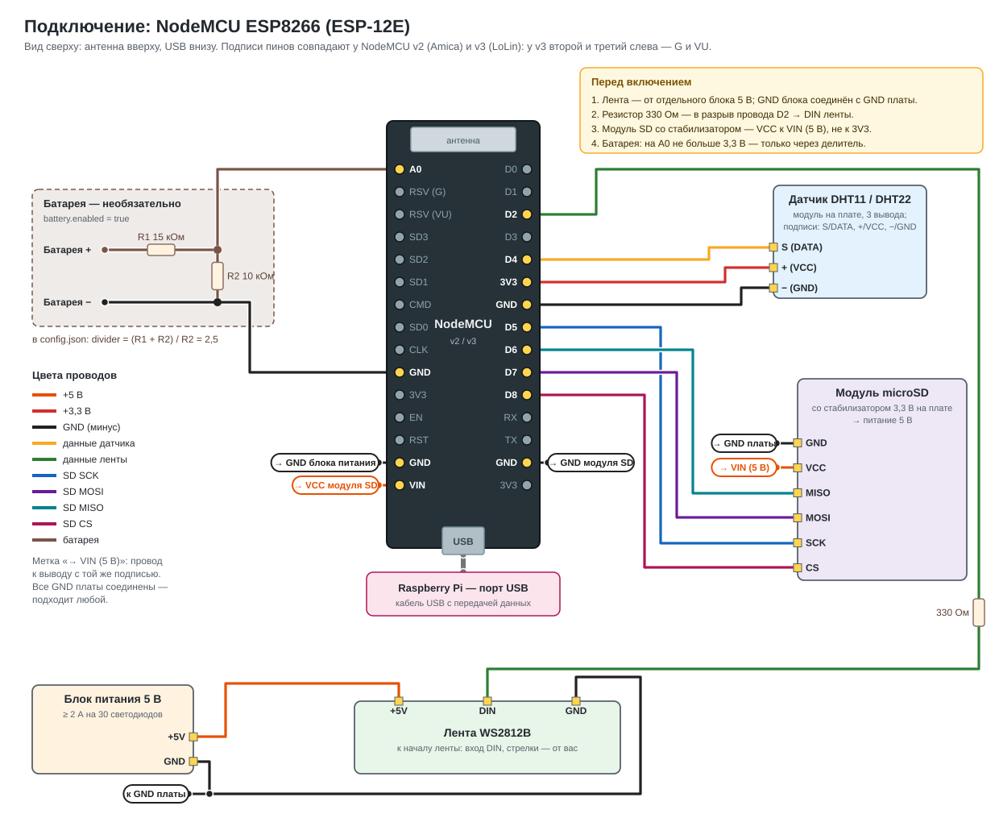
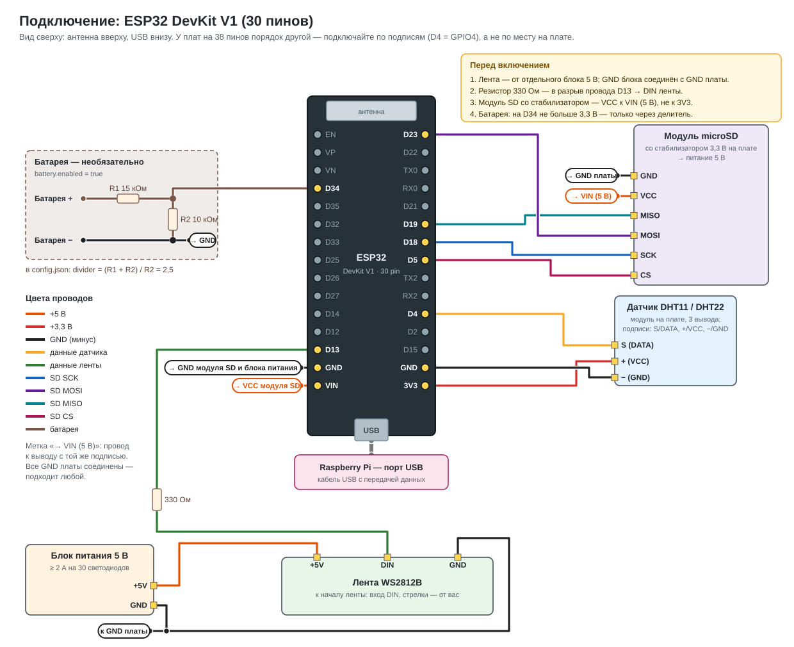

# Подключение оборудования

Схемы генерируются из одной таблицы пинов, совпадающей с
[firmware/empolimer/board.h](../firmware/empolimer/board.h):
`python3 docs/wiring/generate.py`. Любой модуль можно не ставить — прошивка
работает без него.

**Как читать схемы.** Сигнальные провода нарисованы линиями своего цвета.
Питание модулей — метками: «→ VIN (5 В)» у вывода модуля значит «провод от
этого вывода к выводу VIN платы»; на плате у VIN стоит ответная метка. Все
выводы GND платы соединены между собой — подходит любой.

Подключайте **по подписям на плате и модуле**, а не по месту на рисунке:
у разных производителей порядок выводов модулей отличается.

Поддерживаются две платы:

| Плата | Как узнать | Схема |
| --- | --- | --- |
| NodeMCU ESP8266 | модуль с надписью ESP-12E (ESP-12F) на плате, подписи пинов D0–D8; v2 (Amica) узкая, v3 (LoLin) широкая | [NodeMCU](#nodemcu-esp8266) |
| ESP32 DevKit V1 | модуль ESP-WROOM-32, подписи D2–D35, 30 пинов | [ESP32](#esp32-devkit-v1-30-пинов) |

NodeMCU v3 (LoLin) шире и на одной макетной плате закрывает все отверстия
с одной стороны — удобнее ставить её на две макетки или использовать провода
«мама-папа».

## NodeMCU ESP8266

| Модуль | Вывод модуля | Вывод NodeMCU | GPIO | Цвет провода |
| --- | --- | --- | --- | --- |
| Датчик DHT | S / DATA | **D4** | 2 | жёлтый |
| | + / VCC | **3V3** | — | красный |
| | − / GND | **GND** | — | чёрный |
| microSD | CS | **D8** | 15 | розовый |
| | SCK | **D5** | 14 | синий |
| | MOSI | **D7** | 13 | фиолетовый |
| | MISO | **D6** | 12 | бирюзовый |
| | VCC | **VIN** (5 В от USB) | — | оранжевый |
| | GND | **GND** | — | чёрный |
| Лента WS2812B | DIN | **D2** через резистор 330 Ом | 4 | зелёный |
| | +5V | +5V блока питания | — | оранжевый |
| | GND | GND блока питания | — | чёрный |
| Блок питания 5 В | GND | **GND** платы | — | чёрный |
| Батарея (необяз.) | средняя точка делителя | **A0** | ADC | коричневый |
| Raspberry | USB | разъём USB платы | — | кабель |

## ESP32 DevKit V1 (30 пинов)

| Модуль | Вывод модуля | Вывод ESP32 | Цвет провода |
| --- | --- | --- | --- |
| Датчик DHT | S / DATA | **D4** | жёлтый |
| | + / VCC | **3V3** | красный |
| | − / GND | **GND** | чёрный |
| microSD | CS | **D5** | розовый |
| | SCK | **D18** | синий |
| | MOSI | **D23** | фиолетовый |
| | MISO | **D19** | бирюзовый |
| | VCC | **VIN** (5 В от USB) | оранжевый |
| | GND | **GND** | чёрный |
| Лента WS2812B | DIN | **D13** через резистор 330 Ом | зелёный |
| | +5V / GND | блок питания 5 В | оранжевый / чёрный |
| Блок питания 5 В | GND | **GND** платы | чёрный |
| Батарея (необяз.) | средняя точка делителя | **D34** | коричневый |
| Raspberry | USB | разъём USB платы | кабель |

У плат ESP32 на 38 пинов те же подписи (D4, D5, D13, D18, D19, D23, D34)
стоят в других местах — ищите их по подписи.

## Модули

**Датчик DHT11 / DHT22.** Модуль на плате с тремя выводами (S, +, −) уже
содержит подтягивающий резистор. Если датчик без платы (4 ножки): решёткой к
себе, ножки вниз, слева направо — VCC, DATA, не подключать, GND; между DATA и
VCC нужен резистор 10 кОм. DHT22 указывается в `config.json`: `"sensor": {"type": 22}`.

**microSD.** Распространённый модуль с микросхемой стабилизатора (AMS1117) и
буфером питается от **5 В** — от 3,3 В он работает ненадёжно. Модуль без
стабилизатора (только разъём и резисторы) — наоборот, только от 3,3 В. Карта —
FAT32, до 32 ГБ.

**Лента WS2812B.** Подключается к **началу**: со стороны, откуда смотрят
стрелки, к выводу DIN (не DOUT).
- Питание — отдельный блок 5 В: каждый светодиод берёт до 60 мА, 30 светодиодов
  при `brightness` 200 и фиолетовом цвете — около 0,7 А, белым — до 1,4 А.
  От USB платы ленту не питать.
- GND блока питания обязательно соединить с GND платы — без этого лента не
  принимает данные.
- Резистор 330 Ом — в разрыв провода данных, ближе к ленте. Конденсатор
  1000 мкФ 10 В между +5V и GND у начала ленты защищает первый светодиод.
- Данные идут уровнем 3,3 В. Обычно этого хватает при проводе до 30 см; если
  лента мигает или горит не тем цветом — поставьте преобразователь уровня
  74AHCT125 между пином и DIN.

**Батарея.** Делитель R1 (к «+») и R2 (к GND), средняя точка — на вход АЦП.
`battery.divider` = (R1 + R2) / R2. Напряжение на входе не должно превышать
3,3 В. Сверьте показание с
мультиметром и при расхождении подправьте `divider`: у NodeMCU свой делитель
на A0 немного меняет коэффициент.

**Raspberry.** Кабель USB должен передавать данные (не только зарядный). ESP
питается от USB Raspberry; лента — по-прежнему от отдельного блока.

## Перед первым включением

1. Прозвоните мультиметром: нет замыкания между 5 В / 3,3 В и GND.
2. Лента: провод данных на DIN, а не на DOUT; GND блока соединён с GND платы.
3. Модуль SD: VCC на VIN (5 В), если у модуля есть стабилизатор.
4. Включите без ленты и карты: в мониторе порта (115200) должен появиться
   журнал `# ЕмПолимер 2.0.0 ...` и состояние. Затем добавляйте модули по одному
   и смотрите, что `sensor`, `sd` стали `true`.

## Станция на Raspberry Pi

| Что | Куда |
| --- | --- |
| ESP | USB-порт (на Pi Zero — через OTG-переходник в порт USB, не PWR) |
| Камера | разъём CSI: Pi 3 — стандартный шлейф, Pi Zero — узкий 22 pin; или USB-камера |
| Дисплей | HDMI (Pi Zero — mini-HDMI) или DSI |
