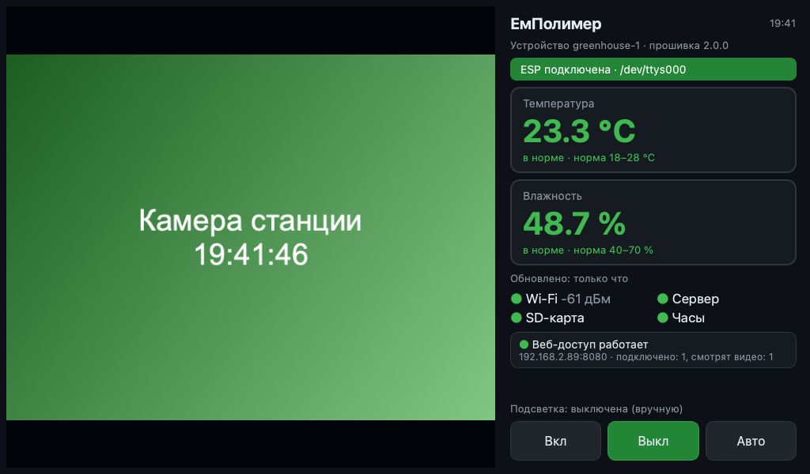

# Станция на Raspberry Pi

Программа выводит на дисплей изображение с камеры и показания ESP, которая
подключена к Raspberry USB-кабелем, и управляет подсветкой. Работает на
Raspberry Pi Zero / Zero 2 W и Pi 3 с Raspberry Pi OS Bookworm (с рабочим
столом).



- **Показания** — температура и влажность; значения вне нормы подсвечиваются,
  при отсутствии новых данных пишется, сколько времени прошло.
- **Состояние ESP** — Wi-Fi, связь с сервером (и сколько измерений ждут
  отправки), SD-карта, часы.
- **Подсветка** — кнопки «Вкл», «Выкл», «Авто» (расписание из `config.json` на SD).
- **Камера** — модуль камеры Raspberry (Picamera2) или USB-камера.
- **Веб-доступ** — та же информация, видео и кнопки подсветки в браузере
  телефона или компьютера в той же сети (ниже).

Каждая часть переживает обрыв: ESP можно отключить и подключить, камера
переподключается сама, без камеры показания всё равно выводятся.
Если часы Raspberry синхронизированы по интернету, станция раз в час
устанавливает время на ESP — тогда журнал на SD ведётся с датами даже без
Wi-Fi у самой ESP.

## Веб-доступ

Станция запускает небольшой веб-сервер (порт `8080`, только стандартная
библиотека Python). Откройте `http://<адрес Raspberry>:8080` или
`http://<имя>.local:8080` — адрес написан на экране станции в строке
«Веб-доступ»; нажатие на неё показывает QR-код для телефона.

На странице: видео с камеры, температура и влажность относительно нормы,
состояние ESP, кнопки подсветки и кнопка «Снимок» — сохранить кадр.
Страница обновляется раз в 2 секунды, видео переподключается само.

Строка «Веб-доступ» на экране станции показывает:

| Состояние | Значение |
| --- | --- |
| ● зелёный «работает» | сервер отвечает на собственную проверку (раз в 10 с); ниже — адрес, сколько устройств подключено и сколько смотрят видео |
| ● красный «не работает» | порт занят другой программой или сервер не отвечает — станция повторяет запуск сама |
| ● серый «выключен» | `web_port = 0` в `station.conf` |

| Адрес | Что отдаёт |
| --- | --- |
| `/` | страница станции |
| `/api/state` | показания, состояние ESP, камеры и сервера (JSON) |
| `/stream.mjpg` | видео (MJPEG); кадры сжимаются только пока кто-то смотрит |
| `/snapshot.jpg` | один кадр |
| `POST /api/light` | `{"mode": "on" \| "off" \| "auto"}` — если `web_control = yes` |

Страница доступна всем в локальной сети без пароля. Если станция стоит в
общей сети, выключите управление (`web_control = no`) или весь веб-доступ
(`web_port = 0`).

## Установка

С компьютера по сети — [deploy/README.md](../deploy/README.md):

```bash
deploy/install.sh pi@192.168.1.50 --autostart
```

Вручную на плате:

```bash
sudo apt install python3-pyqt5 python3-serial python3-picamera2 python3-qrcode
sudo usermod -aG dialout,video $USER   # затем перезагрузка
cp station.conf.example station.conf
python3 station.py
```

## Запуск

```bash
python3 station.py                       # полноэкранно, порт и камера — автоматически
python3 station.py --window              # в окне
python3 station.py --port /dev/ttyACM0   # порт ESP вручную
python3 station.py --camera none         # без камеры
python3 station.py --web-port 0          # без веб-доступа
```

`F11` — окно/полный экран, `Ctrl+Q` — выход.

## Настройки: `station.conf`

| Ключ | По умолчанию | Что задаёт |
| --- | --- | --- |
| `port` | `auto` | порт ESP; `auto` — первый `/dev/ttyUSB*` или `/dev/ttyACM*` |
| `camera` | `auto` | `picamera`, `usb`, `none`; `auto` пробует модуль камеры, затем USB |
| `camera_size` | `640x480` | размер кадра |
| `fps` | `10` | кадров в секунду; на Pi Zero — 5–10 |
| `fullscreen` | `yes` | полноэкранный режим |
| `temp_min`, `temp_max` | `18`, `28` | норма температуры, °C |
| `hum_min`, `hum_max` | `40`, `70` | норма влажности, % |
| `web_port` | `8080` | порт веб-доступа; `0` — выключить |
| `web_control` | `yes` | управлять подсветкой из браузера |
| `stream_fps` | `5` | кадров в секунду в видео для браузера |

## Устройство программы

| Файл | Назначение |
| --- | --- |
| [station.py](station.py) | запуск |
| [station/serial_link.py](station/serial_link.py) | связь с ESP в отдельном потоке, переподключение, синхронизация часов |
| [station/protocol.py](station/protocol.py) | разбор сообщений ESP и команды ([docs/protocol.md](../docs/protocol.md)) |
| [station/camera.py](station/camera.py) | камера в отдельном потоке |
| [station/ui.py](station/ui.py), [station/view.py](station/view.py) | экран |
| [station/state.py](station/state.py) | общее состояние для веб-доступа |
| [station/web.py](station/web.py), [station/web/index.html](station/web/index.html) | веб-сервер и страница |
| [station/config.py](station/config.py) | настройки |

Тесты (без оборудования и без Qt):

```bash
cd rpi
python3 -m unittest discover -s tests -t .
```
